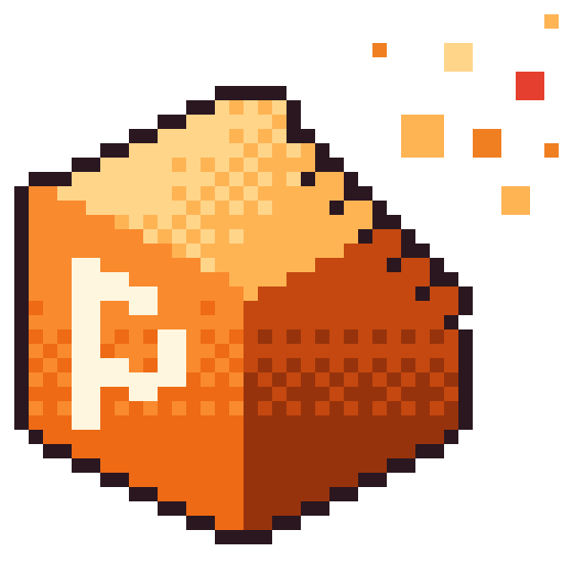
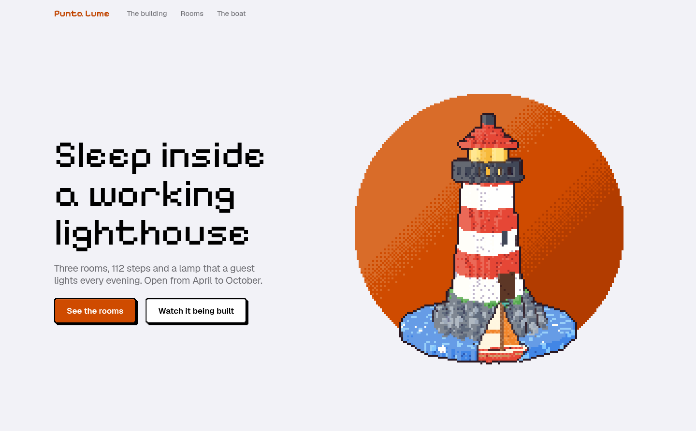
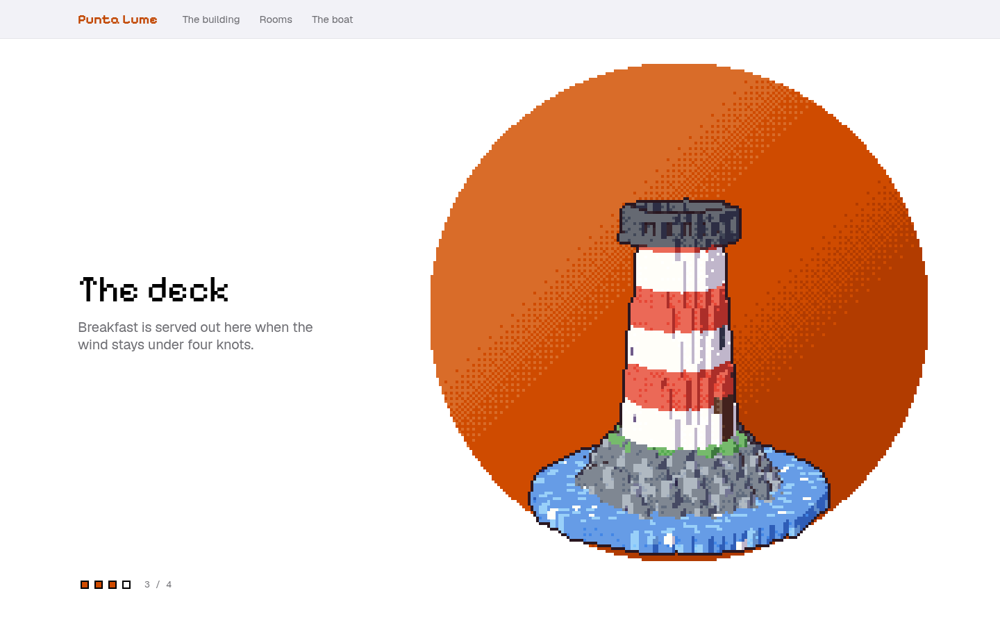

<div align="center">



# Pixelify

A Claude Code skill that builds websites out of voxels and pixel art, with [pleate](https://github.com/Helixo22/pleate).

</div>



## What it does

Type `/pixelify a bakery in Lisbon` and Claude asks a few questions once, plans a scene, models the object of your page
from voxels and builds the site around it. As people scroll, the object assembles, comes apart, opens or bursts.

- **Voxel 3D.** Models in parts, drawn as large pixels with dithered light, a dark contour and a disc behind.
- **Pixel art 2D.** Drawings and scroll scenes on a 96 by 96 canvas, with the dithering of 8 bit games.
- **No files.** Every picture is code. A model weighs about a kilobyte, so pages stay light.
- **A real site.** Text, navigation, buttons and forms are pleate components: accessible, themed, light and dark.
- **Respectful.** Nothing draws off screen, reduced motion is honored, and the page reads without the canvas.



## Install

```bash
git clone https://github.com/Helixo22/pixelify.git
mkdir -p ~/.claude/skills/pixelify
cp -r pixelify/skill/. ~/.claude/skills/pixelify/
```

Start a new Claude Code session and type `/pixelify`. To update, pull and copy again.

## Use

```text
/pixelify a coffee roaster, show the bean becoming a cup
/pixelify portfolio of a furniture maker, voxel chair that assembles
/pixelify small page for a food truck, 2D pixel art
```

It also starts by itself when you ask for a voxel or pixel art website.

## What is inside

| Path | Contents |
| --- | --- |
| `skill/SKILL.md` | The procedure: questions, setup, scene plan, build, rules of the style, checks |
| `skill/references/voxel.md` | Modeling and animating voxels |
| `skill/references/pixel.md` | Drawing pixel art and pixel scenes |
| `skill/references/page.md` | Layout, color, type and performance of the page |
| `assets` | Logo and pictures of this README |

The engine is in pleate, section Voxel3D: `VoxelScene`, `VoxelView`, 12 voxel models, `PixelArt`, `PixelCanvas` and 40
drawings. See them live at [pleate.duckdns.org](https://pleate.duckdns.org/components/voxel-scene).


## Requirements

Claude Code, Node 22.18 or later, and a browser with WebGL2 for the voxel scenes (others get a fallback).

## License

MIT
